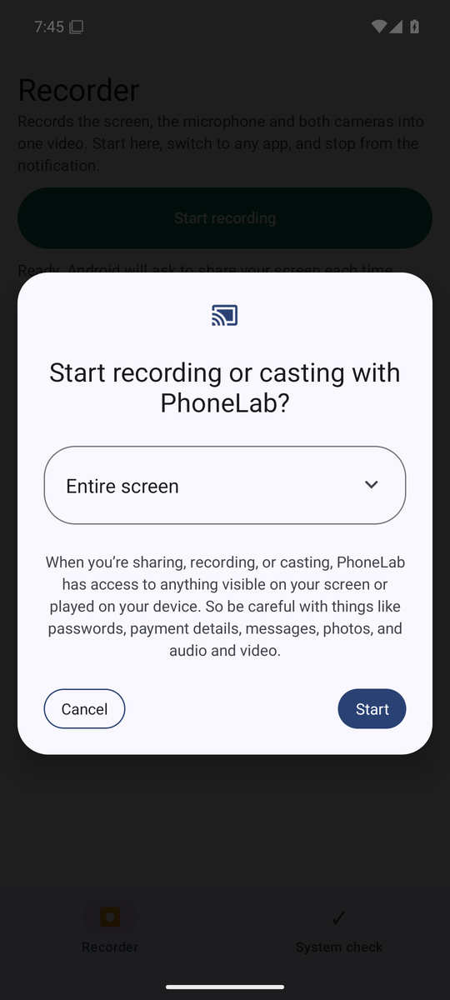
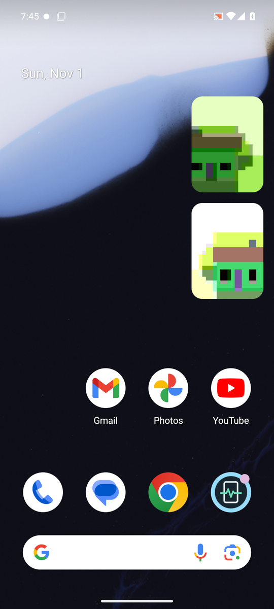
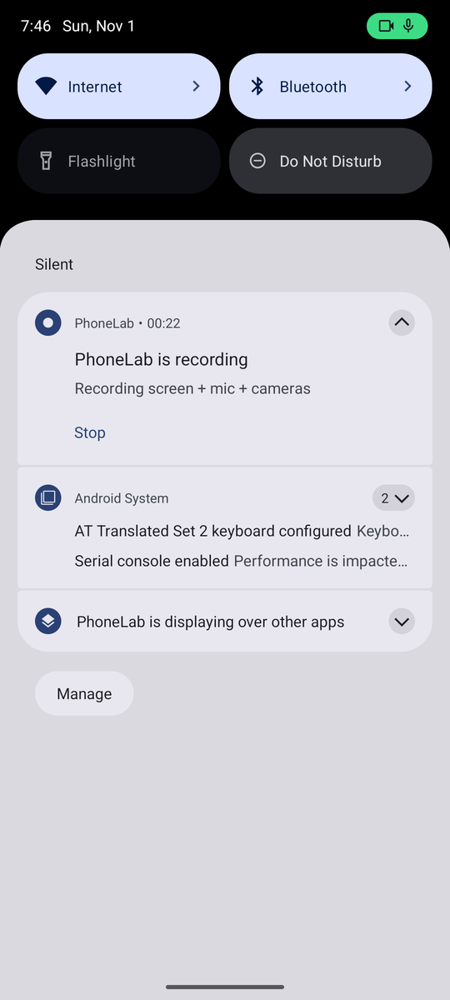
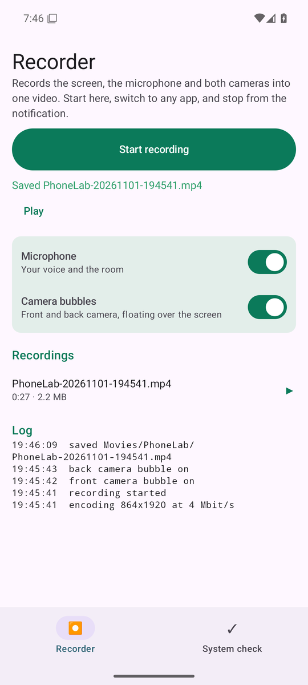
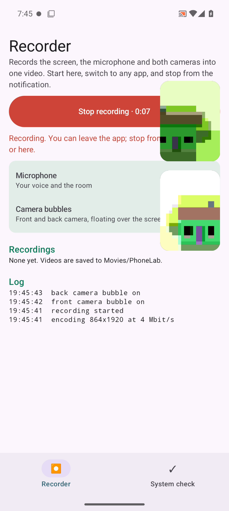

# Recorder: screen, microphone and both cameras in one video

The Recorder tab records the screen and the microphone into one MP4, with
live front and back camera previews floating over whatever app you use. The
screen recording captures the previews, so there is nothing to merge
afterwards. The screenshots come from the Android 15 emulator in CI.

## Recording

1. Open the **Recorder** tab. Leave **Microphone** and **Camera bubbles**
   on, or switch either off.
2. The first time, tap **Allow display over other apps** if the screen asks
   for it; without it the video has no camera bubbles.
3. Tap **Start recording** and allow camera, microphone and notifications if
   asked. Android then asks to share your screen; PhoneLab always asks for
   the entire screen, so the bubbles end up in the video. Tap **Start**.

   

4. Switch to any app. The camera bubbles stay on top; drag them anywhere.

   

5. Stop from the notification, or come back and tap **Stop recording**.

   

The video is saved to `Movies/PhoneLab/PhoneLab-<date>-<time>.mp4`, appears
in your gallery, and is listed in the app with a play button. The log at
the bottom shows the size it encoded at and anything that went wrong, such
as a camera that had to close.

A frame from a recorded video, showing the app and both bubbles inside it:

## How it works

- One foreground service holds the screen capture, camera and microphone, so
  recording continues while you use other apps. Android 14+ requires the
  order the app follows: screen-capture consent first, then the service, then
  the capture itself.
- MediaRecorder encodes H.264 video and AAC audio. The size is the largest
  the phone's encoder accepts at the screen's shape, at 30 frames per second.
- The front camera opens first and the back camera once the front shows a
  frame. If a phone can't run both, the camera that fails closes its bubble
  and the recording continues.

## Limits of this first version

- Microphone only: sound played by other apps isn't recorded yet.
- Camera footage is recorded at bubble size, as part of the screen.
- Bubbles assume the phone is held upright.
- Apps that block screenshots, such as banking apps and Netflix, record as
  black. Android 15 also hides notification contents and one-time codes
  while the screen is being recorded.
