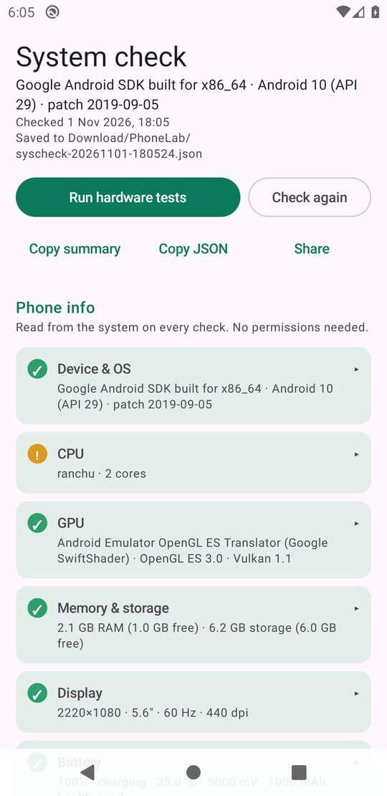
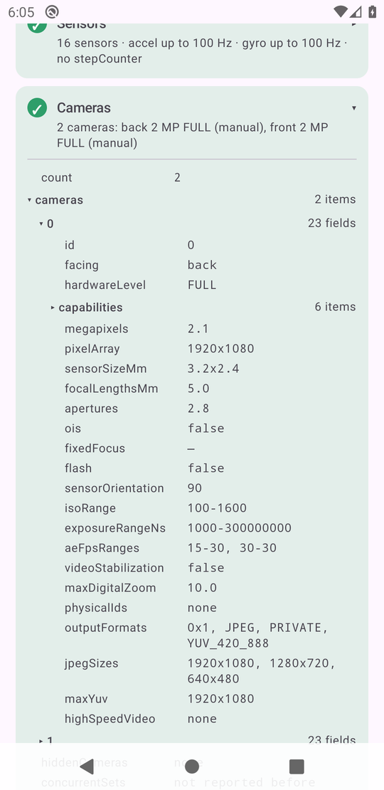
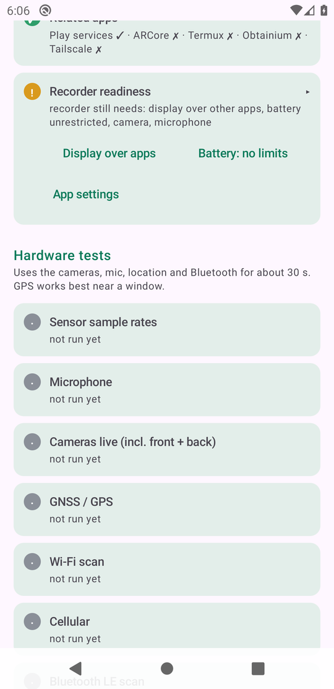
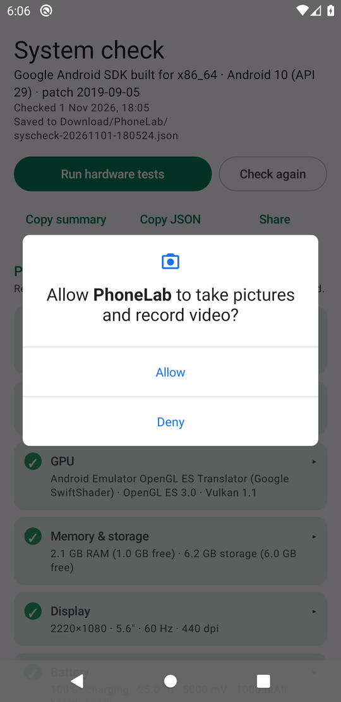
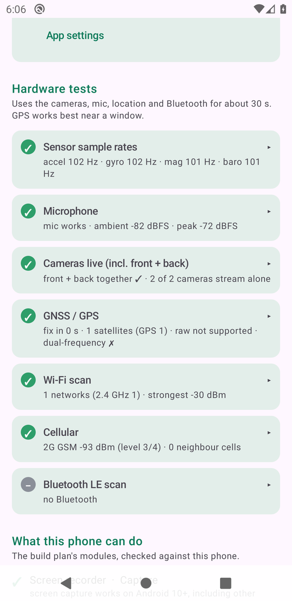
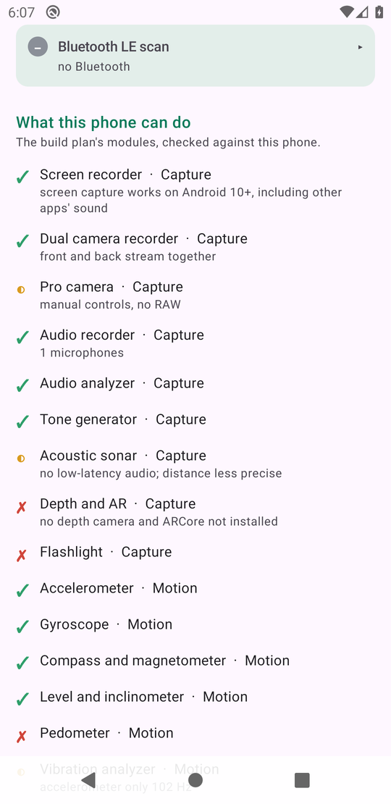

# System check: what it does and how to use it

The system check is the first screen of PhoneLab. It finds out what your
phone can really do, saves that as a report, and marks each module from the
build plan as possible or not on this phone.

The screenshots below come from an emulator in CI (see
[How the screenshots are made](#how-the-screenshots-are-made)), so the
values are the emulator's, not a real phone's.

## 1. First launch: phone info

Open the app. It reads 17 groups of information straight away, without
asking for any permission, and saves the report. Later launches show the
last saved report; tap **Check again** for a fresh one.

Each card has a status and a one-line summary:

| Badge | Meaning |
| --- | --- |
| green ✓ | read fine |
| amber ! | something is missing or limited (for example, temperature sensors not readable) |
| red ✗ | the check failed; the card shows the error |
| grey – | skipped (for example, Bluetooth is off or a permission was refused) |

The phone-info cards are: Device & OS (including the MIUI version), CPU,
GPU, Memory & storage, Display, Battery, Thermal, Sensors, Cameras, Media
codecs, Audio & haptics, Radios, Network, Security, System features,
Related apps, and Recorder readiness.

## 2. Open a card to see everything it read

Tap a card's title to open it. Nested groups open with a tap on their ▸.
Values can be selected and copied.

## 3. Recorder readiness

This card lists what the screen recorder (the next milestone) still needs,
with buttons that open the right settings screen. On MIUI it also offers
**MIUI permissions** (where "Display pop-up windows while running in the
background" lives) and **MIUI autostart**. The card refreshes whenever you
come back to the app.

## 4. Hardware tests

Turn on Location, Wi-Fi and Bluetooth, go near a window, then tap **Run
hardware tests**. Android asks for camera, microphone and location access;
a test whose permission you refuse is marked skipped.

The tests take about 30 to 60 seconds:

- **Sensor sample rates:** streams the main sensors at full speed for 3 s
  and measures the rate each one really delivers.
- **Microphone:** records 1.5 s and reports the level. Nothing is kept.
- **Cameras live:** streams each camera alone, then every pair together.
  This is how we learn whether front and back can run at once, which
  Android 10 doesn't report.
- **GNSS / GPS:** listens for up to 30 s: satellites per constellation,
  time to fix, raw measurements, and dual-frequency (L5) support.
- **Wi-Fi scan, Cellular, Bluetooth LE scan:** counts, bands and signal
  strength.

## 5. What this phone can do

At the bottom, all 52 modules from the build plan are marked against the
results: ✓ possible, ◐ partly, ✗ not on this phone, ? not known until the
hardware tests run.

## Saving and sharing

Every run is saved twice: in the app's own storage, and as a copy in
`Download/PhoneLab/syscheck-<date>-<time>.json`, which you can open with any
file manager. The header shows where it was saved.

| Button | What it does |
| --- | --- |
| **Copy summary** | copies a short text version (one line per check, plus the module list) for pasting into a chat |
| **Copy JSON** | copies the full report |
| **Share** | sends the JSON file, with the summary as text, to any app |

No identifiers are saved: no IMEI, serial number, MAC addresses, network
names, cell IDs or coordinates.

## How the screenshots are made

After every build, CI starts two emulators, Android 15 (like the target moto g55)
and Android 10 (the oldest supported version), installs the
APK and walks through the app with `scripts/screenshots.sh`: it waits for
the first check, opens a card, scrolls, taps **Run hardware tests**, allows
the permission dialogs and waits for the results. It uploads the
screenshots, the report the app saved, and logcat as the `screenshots-<version>`
artifact, and the job fails if the app crashes.

The emulator differs from a real phone: no Bluetooth, no hardware video
encoder, unreadable CPU speeds and temperatures, and a single simulated
satellite. The app follows the phone's dark-mode setting; the Android 15 run
also takes a dark-theme screenshot.
